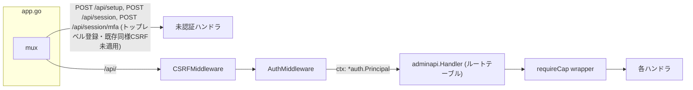

# P1: 複数管理者・ロール/権限モデル・2FA・セッション管理 — 詳細設計

roadmap-to-wp-parity.md P1(5〜8)を1件の設計としてまとめる。対象4項目:
5. 複数管理者ユーザーのCRUD(API+管理SPA)
6. ロール・権限モデル(capability-based、権限昇格をルーティング層で構造的に防止)
7. TOTP 2FA
8. セッション管理(一覧・個別失効・パスワード変更時の全失効)

設計プロセス: architect 3種(simplest-possible / security-strictness-first / migration-risk-first)による独立候補生成 → critic(JUDGE mode)による評価。**採用: migration-risk-firstの候補**を土台に、他候補からの移植と、3候補共通の盲点への対処を加えた。

## 1. Overview

既存の単一管理者スキーマ(`users`: id/username/password_hash/created_at、`sessions`: token_hash/user_id/created_at/expires_at)に、追記のみ・後方互換のマイグレーションでロール列とTOTP関連テーブルを追加する。認可は`adminapi.Handler`をハンドラ手動登録から**ルートテーブル**に変え、`route()`コンストラクタに権限(capability)を必須引数として要求し、権限を渡さない登録はコンパイルエラーに、`CapNone`を渡すと起動時パニックにする。ロール→権限の対応はコード内の静的マップとし、DBの`role`列はCHECKで既知の4値に固定する。2FAの半認証状態は既存の`sessions`テーブルを汚さず、専用の`mfa_challenges`テーブルに隔離することで、`ValidateSession`が半認証トークンを受理する経路を構造的に排除する。ロールバックは全段階「直前のバイナリを再デプロイ」で完結し、ダウンマイグレーションは書かない(ADR-0006)。

## 2. Architecture



- **新規**: `internal/auth/capability.go`(Capability/Role型、ロール→権限マップ)、`internal/auth/totp/`(RFC 6238実装)、`internal/adminapi/routes.go`(ルートテーブル本体)、`internal/adminapi/users.go`(ユーザーCRUD)、`internal/adminapi/mfa.go`、`internal/adminapi/sessions.go`(自分のセッション一覧/失効)、`internal/storage/users_admin.go`(ユーザーCRUD・ロール更新・削除時カスケード)。
- **変更**: `internal/adminapi/handler.go`(ルートテーブル化)、`internal/auth/middleware.go`(`AuthMiddleware`がPrincipalをcontextに格納。`CSRFMiddleware`のContent-Type検査対象に`PATCH`を追加 — §5で新設する`PATCH /api/users/{id}`のため)、`internal/auth/session.go`(pending判定を`mfa_challenges`側に分離)、`internal/adminapi/posts.go`(`currentUserID`をcontext読み取り+フォールバック化する`currentPrincipal`に置き換え、`UpdatePost`/`DeletePost`/`GetPost`に`authDB`を追加。§4参照)、`internal/app/app.go`(`POST /api/session/mfa`を既存の`POST /api/setup`・`POST /api/session`と同じ方式でトップレベルに追加。CSRF未適用のギャップはP1では修正しない。§6.3参照)。
- 既存境界ルール(`internal/app`のみが横断importを持つ)は維持。`internal/authz`のような新パッケージは作らず、権限ロジックは既存の`internal/auth`に置く(architect Bの新パッケージ案は不採用 — 理由は§6)。

## 3. Data model

3本の追記のみマイグレーション。1ファイル=1トランザクション、フォーワードのみ(ADR-0006)。

**`0003_user_roles.sql`**
```sql
-- 0003_user_roles.sql
-- roadmap-to-wp-parity.md P1-6: ロール列を追加し、既存の唯一の管理者行を
-- administrator に補正する。DEFAULT は 'administrator' とする(最小権限
-- 'contributor' ではない) — 理由: この列を追加した段階のバイナリを
-- ロールバックした場合に実行され得る唯一の INSERT は
-- storage.CreateFirstAdmin(setup.go:46-49、role列を持たない旧SQL文)
-- であり、そのINSERTが唯一使うのがこのDEFAULTである。'contributor'に
-- していると、デプロイ→ロールバック→初回セットアップ、という順序で
-- 管理者が一人も存在しないインストールが生成され、CreateFirstAdmin の
-- count(*)>0 ガードにより再試行もできなくなる(レビューで発見)。
-- 将来のユーザーCRUD(POST /api/users)はroleを常に明示指定するため、
-- このDEFAULTが「不慮のINSERT」に対するフェイルセーフとして機能する
-- 場面は実質ない。
ALTER TABLE users ADD COLUMN role TEXT NOT NULL DEFAULT 'administrator'
  CHECK (role IN ('administrator','editor','author','contributor'));
UPDATE users SET role = 'administrator';
```
既存行は全てこのマイグレーション実行時点で管理者だったユーザーなので、無条件に`administrator`へ補正する。`storage.CreateFirstAdmin`(`internal/storage/setup.go:46-49`)は、この段階のデプロイ後もroleを指定しないINSERTのままで正しく動作する(DEFAULTが`'administrator'`のため)。将来のユーザーCRUD実装時に、新規INSERT文では`role`を明示的に指定することを徹底する。

**`0006_sessions_meta.sql`**(実装順の訂正 — 当初`0004`として設計されたが、T10のMFAテーブル追加(`0005_mfa.sql`)がT7より先に実施され出荷済みとなったため、実装時に`0006`へ改番した。`storage.Migrate`はファイル名の辞書順で`schema_migrations.version`を連番付与し、ファイル名の数値部分は解析しないため、既存DBが`0005_mfa.sql`をversion=4として記録済みの状態で数値の小さい`0004`を追記すると、そのversionが既適用扱いで永久にスキップされてしまう。詳細はマイグレーションファイル冒頭のコメント参照)
```sql
-- 0006_sessions_meta.sql
-- roadmap-to-wp-parity.md P1-8: セッション一覧UI用のメタデータ。
-- last_seen_at は追加しない — SetMaxOpenConns(1) 下で認証済みリクエスト
-- 毎に書き込みが発生するコストに対し、UI上の価値が低いため。
ALTER TABLE sessions ADD COLUMN user_agent TEXT;
ALTER TABLE sessions ADD COLUMN created_ip TEXT;
CREATE INDEX idx_sessions_user ON sessions(user_id);
```
既存セッション行は`user_agent`/`created_ip`が`NULL`のまま有効に動作し続ける(デプロイ時に強制ログアウトしない)。

**`0005_mfa.sql`**
```sql
-- 0005_mfa.sql
-- roadmap-to-wp-parity.md P1-7: TOTP登録情報・リカバリコード・
-- ログイン2段目チャレンジ。mfa_challenges を sessions と分離するのは、
-- 半認証トークンが ValidateSession の参照先テーブルに一切現れない
-- ようにするため(構造的な安全性 — auth.ValidateSession のバグが
-- あっても本セッションは発行され得ない)。
CREATE TABLE user_totp (
  user_id         INTEGER PRIMARY KEY REFERENCES users(id),
  secret          TEXT NOT NULL,
  confirmed_at    INTEGER,          -- NULL = 登録開始したが未確認(未有効)
  last_used_step  INTEGER NOT NULL DEFAULT 0  -- リプレイ防止
);

CREATE TABLE mfa_recovery_codes (
  user_id   INTEGER NOT NULL REFERENCES users(id),
  code_hash TEXT NOT NULL,          -- bcrypt
  used_at   INTEGER,
  PRIMARY KEY (user_id, code_hash)
);

CREATE TABLE mfa_challenges (
  token_hash TEXT PRIMARY KEY,      -- cookie値のSHA-256、sessionsと同じ方式
  user_id    INTEGER NOT NULL REFERENCES users(id),
  expires_at INTEGER NOT NULL       -- 5分固定TTL
);

CREATE TABLE mfa_failures (
  user_id        INTEGER PRIMARY KEY,
  fail_count     INTEGER NOT NULL DEFAULT 0,
  last_failed_at INTEGER NOT NULL,
  locked_until   INTEGER
);
```
`mfa_failures`は`user_id`キー(architect Bからの移植 — 既存`login_failures`は`username`キーだが、TOTP検証はパスワード検証後で識別子が確定しているため`user_id`の方が安全かつリネーム耐性がある)。

`login_failures`(username キー、変更なし)への影響: ユーザー削除時は同一トランザクション内で`DELETE FROM login_failures WHERE username=?`を行う(削除しないと同名ユーザー再作成時にロックアウト状態を継承してしまう)。ユーザー名の変更(rename)はP1では提供しない — キーの陳腐化を避けるため。

## 4. 権限モデル(capability-based、構造的に権限昇格を防止)

`internal/auth/capability.go`:
```go
type Capability uint16
const (
    CapNone Capability = 0
    CapPostsRead        Capability = 1 << iota
    CapPostsEditOwn
    CapPostsEditOthers
    CapPostsPublish
    CapUsersManage
    CapSettingsManage
    CapSelfManage // アカウント設定・2FA・自分のセッション一覧/失効
)

type Role string
const (
    RoleAdministrator Role = "administrator"
    RoleEditor        Role = "editor"
    RoleAuthor        Role = "author"
    RoleContributor   Role = "contributor"
)

var roleCaps = map[Role]Capability{
    RoleAdministrator: CapPostsRead | CapPostsEditOwn | CapPostsEditOthers | CapPostsPublish | CapUsersManage | CapSettingsManage | CapSelfManage,
    RoleEditor:        CapPostsRead | CapPostsEditOwn | CapPostsEditOthers | CapPostsPublish | CapSelfManage,
    RoleAuthor:        CapPostsRead | CapPostsEditOwn | CapPostsPublish | CapSelfManage,
    RoleContributor:   CapPostsRead | CapPostsEditOwn | CapSelfManage,
}

func (r Role) Has(c Capability) bool { return roleCaps[r]&c == c } // 未知のroleはゼロ値マップ参照 -> false
```
未知のロール文字列(手動DB編集等)は`roleCaps`に存在しないため`Has`が常に`false`を返す — フェイルクローズ。

`internal/adminapi/routes.go`:
```go
type routeEntry struct {
    pattern string
    cap     auth.Capability
    h       http.Handler
}

func route(pattern string, cap auth.Capability, h http.Handler) routeEntry {
    if cap == auth.CapNone {
        panic("adminapi: route " + pattern + " registered without a capability")
    }
    return routeEntry{pattern, cap, h}
}

func Handler(contentDB, authDB *sql.DB) http.Handler {
    mux := http.NewServeMux()
    for _, rt := range routes(contentDB, authDB) {
        mux.Handle(rt.pattern, requireCap(rt.cap, rt.h))
    }
    return mux // *http.ServeMux ではなく http.Handler を返す — 呼び出し側が後からmux.Handleで
                // 無防備なルートを追加できないようにする
}

func requireCap(cap auth.Capability, next http.Handler) http.Handler {
    return http.HandlerFunc(func(w http.ResponseWriter, r *http.Request) {
        p, ok := auth.PrincipalFrom(r.Context())
        if !ok {
            writeError(w, http.StatusUnauthorized, "unauthorized")
            return
        }
        if !p.Role.Has(cap) {
            writeError(w, http.StatusForbidden, "forbidden")
            return
        }
        next.ServeHTTP(w, r)
    })
}
```
`routes()`はA(simplest-possible)の宣言的テーブル形状を採用(architect Aからの移植) — テーブルを反復するテスト(「全ルートがCapNone以外を持つ」)と、ロール×ルートの403マトリクステストが自然に書ける。

`AuthMiddleware`(`internal/auth/middleware.go:27`)は認証成功時に`Principal{UserID, Role}`をcontextへ格納する(セッション検証と同じクエリに`users.role`をJOINして1往復で取得)。

**記事の所有権チェックにはRoleが必要であり、`currentUserID`(UserIDのみを返す)は不十分** — レビューで発見された欠陥。`internal/adminapi/posts.go:188`の`currentUserID`は、UserIDだけでなくRoleも返す`currentPrincipal`に置き換える:
```go
func currentPrincipal(r *http.Request, authDB *sql.DB) (auth.Principal, bool) {
    if p, ok := auth.PrincipalFrom(r.Context()); ok {
        return p, true
    }
    // ミドルウェアを経由しない直接ハンドラテスト用のフォールバック(既存の振る舞いを保持)。
    // UserIDだけでなくRoleもauthDBから引く必要があるため、既存のValidateSessionでは
    // 足りず、users.roleをJOINする専用の内部クエリ(auth.ValidateSessionWithRole)を
    // 新設する。
    cookie, err := r.Cookie(sessionCookieName)
    if err != nil {
        return auth.Principal{}, false
    }
    return auth.ValidateSessionWithRole(r.Context(), authDB, cookie.Value)
}
```
既存の「ミドルウェアを経由しない直接ハンドラテストでも動く」契約(posts.go:184-188のコメント)を破らないためのフォールバック — この一手で`AuthMiddleware`本体のテストは書き換えを避けられる(architect Bはミドルウェア全体を削除する設計で、既存テスト21箇所の書き換えが必要になり不採用)。ただし以下は既存テストへの実際の影響であり、正直に明記する:

- `UpdatePost`・`DeletePost`・`GetPost`(`internal/adminapi/posts.go`)は現在`contentDB`のみを受け取り`authDB`を持たない(`ListPosts`/`CreatePost`も同様に確認済み、CreatePostのみ`authDB`を既に受け取る)。所有権チェックのために`currentPrincipal(r, authDB)`を呼ぶ必要があるため、この3関数は`authDB`を追加の引数として受け取るよう署名変更が必要。`internal/adminapi/handler.go`の該当行(`GetPost(contentDB)`等)も`authDB`を渡すように変更する。
- これに伴い、これら3関数の既存テスト(`posts_test.go`)で直接呼び出している箇所は、呼び出し引数に`authDB`を追加する変更が必要になる。「既存テストの書き換えゼロ」ではなく「シグネチャ変更に伴う機械的な引数追加のみ」というのが正確な影響範囲であり、§10のテスト戦略はこれを前提に更新する。

**記事の所有権(row-level)はルート権限では表現しない**: `CapPostsEditOthers`を持たないロールが自分の記事以外を編集しようとした場合は、ハンドラ内で`post.AuthorID != principal.UserID && !principal.Role.Has(auth.CapPostsEditOthers)`を明示的にチェックする(3候補全てがここをハンドラ内if文としており、構造的な保証はない — §7で明記)。

**公開(`status:"published"`)もルート権限では表現しない**: `POST /api/posts`・`PUT /api/posts/{id}`のルート権限は`CapPostsEditOwn`であり、これはcontributor/authorも持つ。しかし`CapPostsPublish`はeditor/administrator限定であるべき(roleCapsの定義通り)。body依存の権限のため`requireCap`(ルート単位)では構造的に検証できず、所有権チェックと同じくハンドラ内チェックが必要: リクエストの`Status`が`"published"`で、かつ`principal.Role.Has(auth.CapPostsPublish)`がfalseの場合は403を返す(作成・更新の両方)。これを怠ると、`CapPostsEditOwn`のみを持つロールがbody操作だけで公開状態の記事を作成できてしまう(実装時に発見されたギャップ、tasks.md T4bで対応)。

## 5. API contracts

| エンドポイント | 権限 | 備考 |
|---|---|---|
| `POST /api/setup` | 未認証 | 変更なし(0003のDEFAULT='administrator'により無修正で正しく動作。§3参照) |
| `POST /api/session` | 未認証 | 2FA有効時は`200 {"mfa_required":true,"mfa_token":"..."}`、無効時は`204`(既存動作維持) |
| `POST /api/session/mfa` | 未認証(mfa_token必須) | body`{mfa_token, code}`。成功時`mfa_challenges`行を消費し本セッション発行、`204` |
| `DELETE /api/session` | `CapSelfManage`相当(認証のみ) | 既存 |
| `GET/POST /api/users` | `CapUsersManage` | POST body`{username,password,role}`。role不正は400 |
| `GET/PATCH/DELETE /api/users/{id}` | `CapUsersManage` | DELETEは`?reassign_to=<id>`必須(§6) |
| `DELETE /api/users/{id}/sessions` | `CapUsersManage` | 他ユーザーの全セッション強制失効 |
| `DELETE /api/users/{id}/mfa` | `CapUsersManage` | 2FAロックアウト救済用リセット |
| `PUT /api/account/password` | `CapSelfManage` | 既存。`DeleteSessionsByUserID`は変更なし |
| `POST /api/account/mfa` | `CapSelfManage` | 登録開始。body: 現在のパスワード。応答: secret+otpauth URI |
| `POST /api/account/mfa/confirm` | `CapSelfManage` | body`{code}`。成功で`confirmed_at`設定+リカバリコード10件を1度だけ返す |
| `DELETE /api/account/mfa` | `CapSelfManage` | body: 現在のパスワード |
| `GET /api/account/sessions` | `CapSelfManage` | 自分のセッション一覧。`token_hash`は公開しない(短縮id使用、下記参照) |
| `DELETE /api/account/sessions/{id}` | `CapSelfManage` | 下記参照。他人のセッションは404 |
| 記事系(既存) | `CapPostsRead`/`CapPostsEditOwn`/`CapPostsPublish` + ハンドラ内所有権チェック | 既存パスに権限ラベルを付与するのみ |
| `GET/PUT /api/settings` | `CapSettingsManage` | 既存 |
| `GET /api/account` | `CapSelfManage` | 新規。SPAの「現在のユーザー」状態源: `{id,username,role,capabilities:[...]}` |

エラーボディは既存`{"error":"..."}`形式を継続。403は`{"error":"forbidden"}`。

**セッション一覧/削除のid方式(レビューで発見された欠陥への対処)**: `token_hash LIKE ?`の素朴な前方一致は、(a)十分な桁数を確保しないとプレフィックス衝突で無関係のセッションを削除してしまう、(b)`{id}`に`%`や`_`が含まれるとSQLの`LIKE`ワイルドカードとして解釈されエスケープが必要、という2つの問題を持つため不採用。代わりに`GET /api/account/sessions`は`substr(token_hash,1,16)`をidとして返し(16桁hexで衝突確率は無視できる)、`DELETE /api/account/sessions/{id}`は`WHERE user_id=? AND substr(token_hash,1,16)=?`という等価比較(`LIKE`ではない、ワイルドカード解釈なし)で照合する。

## 6. Key flows

### 6.1 TOTP ログインフロー
1. `POST /api/session` — 既存の`auth.Authenticate`(ロックアウト・パスワード検証、`username`キー)を通す。この関数は`login_failures`(usernameキー)のみを扱い、2FA用の`mfa_failures`(user_idキー)には触れない — 2テーブルは完全に独立しており、片方をリセットしても他方には影響しない(レビューで、両者に因果関係があるという誤った前提が見つかったため明記する)。
2. 成功後、`user_totp.confirmed_at IS NOT NULL`なら以下を行う:
   - `mfa_failures`(`user_id`キー)を先にチェックし、`locked_until`が未来なら**ここで429を返し、チャレンジ行を作らない**(ロックアウト中はチャレンジの増殖もTOTP試行も許可しない)。
   - ロックされていなければ、32バイトのランダム値を生成し、その値のSHA-256を`mfa_challenges.token_hash`に保存(既存`sessions`のトークン管理と同一方式)、生成した生の値をJSON応答`{"mfa_required":true,"mfa_token":"<生の値>"}`で返す(cookieではない — `mfa_challenges.token_hash`のコメントはこれを明記する)。TTLは5分。
   - 未登録/未確認なら通常の`IssueSession`で`204`(既存契約を維持)。
3. `POST /api/session/mfa {mfa_token, code}` — 受け取った`mfa_token`をSHA-256して`mfa_challenges`を検索(該当なし/期限切れは404)。**検証前に再度`mfa_failures.locked_until`をチェックする**(ステップ2から時間が経過している可能性があるため — このチェックを省くとロック期間中の最後の1回がすり抜ける)。ロックされていなければTOTP検証(RFC 6238、±1ステップ許容、`last_used_step`以下は拒否=リプレイ防止)またはリカバリコード一致(bcryptハッシュ照合、`used_at`未設定のもののみ、使用後即マーク)。
4. 検証成功 → `mfa_challenges`行を削除 → `last_used_step`を更新 → 本セッション発行(`IssueSession`)。
5. 検証失敗 → `mfa_failures`を加算、10回で15分ロック(チャレンジ行はそのまま残し、TTL内は再試行可能)。

**`mfa_challenges`の期限切れ行の掃除**: `sessions`の遅延失効(`session.go:68`相当)と同じ方針で、`ValidateSession`等の読み取り時に都度削除するのではなく、新しいチャレンジをINSERTする直前に`DELETE FROM mfa_challenges WHERE expires_at < ?`(現在時刻)を同一トランザクションで実行し、無期限の行の蓄積を防ぐ(パスワードを知っている攻撃者が繰り返しログインしてチャレンジ行を増殖させるDoSへの対処)。

### 6.2 ユーザー削除(最後の管理者保護 + FK制約)
3候補全てが見落としていた点(critic判定時に発見): `internal/storage/sqlite.go`で`foreign_keys(1)`が有効かつ`posts.author_id`・`sessions.user_id`が`REFERENCES users(id)`(デフォルトRESTRICT)なため、**記事の再割当なしに`DELETE FROM users`は外部キー制約違反で失敗する**。
- `DELETE /api/users/{id}`は`?reassign_to=<id>`を必須パラメータとする。以下は400で拒否する(レビューで発見 — 未検証のままだとFK違反で500になる): `reassign_to`が省略された場合、`reassign_to == id`(自己参照、UPDATEは成立するが無意味)の場合、`reassign_to`が存在しないユーザーIDの場合(事前に`SELECT count(*) FROM users WHERE id=?`で確認)。
- 1つの`immediate`トランザクション内で: (a)`SELECT count(*) FROM users WHERE role='administrator' AND id != ?` → 対象が管理者かつこれが0なら409「最後の管理者は削除できません」、(b)自己削除は別途409、(c)`UPDATE posts SET author_id=? WHERE author_id=?`(reassign_to)、(d)`DELETE FROM sessions WHERE user_id=?`、(e)`DELETE FROM login_failures WHERE username=?`、(f)`DELETE FROM user_totp/mfa_recovery_codes/mfa_failures/mfa_challenges WHERE user_id=?`(**`mfa_challenges`も忘れず含める** — レビューで発見: 2FAログインの5分間の待機中に対象ユーザーが削除されると、このテーブルへの未削除の参照行がFK違反で最終DELETEを失敗させる)、(g)`DELETE FROM users WHERE id=?`。
- 全て`tx.*`呼び出しで統一する(`db.*`と混在させない — `SetMaxOpenConns(1)`下でのデッドロック回避、design.md:155の既存ルール)。`internal/storage/users_admin.go`の新規関数は`*sql.Tx`を受け取る形にし、`*sql.DB`版とは分離する。
- **ロール変更(降格)も削除と同じ1つの`immediate`トランザクション内で行う**(レビューで発見: 降格を「チェックしてから更新」という2つの独立した`db.*`呼び出しに分けると、`SetMaxOpenConns(1)`はSQL文単位の直列化しか保証せず、2つの同時PATCHリクエストが両方「他に管理者が1人いる」と読んでから両方降格を実行し、管理者ゼロのインストールが生まれる)。対象が現在administratorで、変更後のロールがadministratorでなく、かつ`SELECT count(*) FROM users WHERE role='administrator' AND id != ?`が0なら同一トランザクション内で409。

### 6.3 CSRF適用の既存ギャップ(スコープを明示・P1では修正しない)
`internal/app/app.go:54-55`で`POST /api/setup`・`POST /api/session`はトップレベル登録のため`CSRFMiddleware`を経由していない(`/api/`ワイルドカードより厳密パターンが優先される)。これはP1着手前から存在する既存の欠陥であり、**P1の一部としては直さない**。理由: 未認証エンドポイントへのCSRF適用はOrigin検証の意味が薄く(認証済みリクエストの偽造防止が目的)、影響範囲の異なる修正をP1に混ぜるとレビューが困難になる。`POST /api/session/mfa`は同種の未認証・cookie保持エンドポイントのため、既存の2エンドポイントと同じ登録方式(トップレベル)に揃える — 新たな不整合を作らない一貫性を優先し、CSRF適用の是非は別issueとして`docs/plans/roadmap-to-wp-parity.md`にフォローアップ項目を追記する。

**この既存ギャップは`adminapi.Handler`のルートテーブル機構では一切防げない**(レビューで発見された、§4・§8の過大な主張の訂正): `route()`のCapNoneパニックと`Handler`が`http.Handler`を返す設計は、`adminapi.Handler`が構築する内側のmuxしか保護しない。`internal/app/app.go`のトップレベルmux自体に将来誰かが`mux.Handle("POST /api/xxx", ...)`のような厳密パターンを追加すれば、`/api/`ワイルドカードより優先されるため、CSRF・Auth・requireCapを一切経由せずにハンドラへ到達できる。これは**P1で新たに生まれる穴ではなく、既存の`POST /api/setup`・`POST /api/session`が既に体現している構造であり、P1のルートテーブル機構が対処する範囲の外にある**。§8でcandidate Bを退けた根拠(「app.goへの直接追加で認証すら通らない」)は本設計にも同一の形で当てはまるため、その部分の記述は誤りとして訂正する — 採用理由はB案よりも既存テストへの影響が小さいこと(§4)であり、この穴を塞いでいることではない。緩和策として、`internal/app`のテストに「トップレベルmuxが`POST /api/setup`・`POST /api/session`・`POST /api/session/mfa`・`/api/`の4パターン以外を登録していないこと」を検証するテストを1本追加する(レビュー・アシスタントを含む将来のレビュアーが検知できるようにする、完全な構造的防止ではなく検知の仕組み)。

## 7. 共通の盲点への対応まとめ

criticのJUDGE結果で3候補全てに共通して発見された欠落と、本設計での対処:

1. **ユーザー削除がFK制約で実行不可能**(§6.2で対処): reassign_to必須化+カスケード削除(`mfa_challenges`含む)を1トランザクションに統合。
2. **`*sql.Tx`版storage関数の欠如**: `internal/storage/users.go`・`sessions.go`の既存関数は全て`*sql.DB`を受け取り、`*sql.Tx`版が存在しない。最後の管理者チェック等のトランザクショナルな処理のために、`internal/storage/users_admin.go`に`*sql.Tx`を第一引数に取る関数群を新設する(既存の`*sql.DB`版はラッパーとして残し、単発呼び出しの後方互換を保つ)。
3. **セットアップ時のroleデフォルト**: 0003マイグレーションの列デフォルトを`'administrator'`にすることで対処(§3参照)。当初案(デフォルト`'contributor'`+`setup.go`のINSERT文修正)は、デプロイ→ロールバックの経路で旧バイナリの`INSERT`(role列なし)がデフォルト値に依存するため、ロールバック後の初回セットアップで管理者不在のインストールを生む欠陥があった(2回目の独立レビューで発見)。`storage.CreateFirstAdmin`のINSERT文自体は変更不要。テストで「セットアップ直後の最初のユーザーのroleがadministratorであること」を明示的にアサートする。

## 8. Alternatives considered

- **B案(security-strictness-first)の`internal/authz`新パッケージ+`AuthMiddleware`完全削除+`Principal`を型引数で明示伝播**: 権限昇格防止としては最も強いが、既存21箇所の直接ハンドラテストが`AuthMiddleware`前提の`currentUserID`パターンに依存しており全面書き換えが必要になる。conventions/effort両方で不利と判断し不採用。ルートテーブルの形状(§4)のみ移植。(なお、当初は「B案はapp.goのトップレベルmuxへの直接追加で認証すら通らない穴を生む」を追加の不採用理由としていたが、この穴は採用した設計にも同一の形で存在することが独立レビューで判明したため、不採用の根拠からは削除した。§6.3参照。)
- **DB駆動の`role_capabilities`テーブル(WP風)**: 権限をランタイムデータとして持てば柔軟だが、バイナリロールバックと権限マッピングのロールバックが分離してしまい、不整合な中間状態を生みうる。4ロール固定で十分な現状では、コード内静的マップの方がロールバックの原子性を保証できる。
- **`pending_mfa`列を`sessions`に追加する方式(A案)**: `mfa_challenges`を別テーブルにするより実装は軽いが、半認証セッションが`sessions`テーブルに実在する行として存在し続け、`ValidateSession`が将来変更されたときに`pending_mfa`フラグを見落とすと本セッションとして通ってしまうリスクが残る。構造的な安全性を優先し不採用(宣言的ルートテーブルの形状のみ移植。A案が提案していた`ResetLoginFailures`呼び出し位置の変更は、独立レビューで`login_failures`と`mfa_failures`が無関係のテーブルであることが判明したため採用しなかった — §6.1参照)。

## 9. Cross-cutting

- **エラー処理**: 既存`{"error":"..."}`規約を継続。403は401と区別可能な情報を返さない(forbidden固定文字列)。
- **セキュリティ**: TOTP秘密鍵はDB平文保存とする(A案の指摘通り、既存コードベースに鍵管理機構がなく、1列のためだけにkeyringを新設するのはスコープ外 — DBファイルへの読み取りアクセスがあれば既に`password_hash`とセッションハッシュも奪取可能であり、リスクの相対的増分は限定的と判断)。リカバリコードはbcryptハッシュ化。
- **パフォーマンス**: `AuthMiddleware`が`sessions JOIN users`1クエリでPrincipal取得(現状の2クエリ相当から実質1クエリへ)。`last_seen_at`は追加しない(前述)。
- **可観測性**: 新規追加なし(既存ログ方針を継続)。

## 10. Test strategy outline

- **Unit**: ロール×ルートの403マトリクス(`routes()`テーブルを反復し、各ロールで期待される200/403を検証)。RFC 6238公式テストベクタでのTOTP実装検証。リプレイ防止(`last_used_step`)。最後の管理者削除/降格の409。セットアップ直後のroleアサーション(§7-3)。
- **Integration**(実SQLite、モック禁止方針を継続): マイグレーション0003〜0005の適用+既存単一管理者行の補正確認。ユーザー削除時のカスケード(記事再割当・セッション・login_failures・`mfa_challenges`含むmfa関連の削除)。`reassign_to`の自己参照/存在しないIDの400。降格の同時実行での管理者ゼロ化がトランザクションにより防がれること。2FAログインの2段階フロー(mfa_token発行→ロックアウトチェック→検証→本セッション発行)、およびロック中の再チェック(§6.1ステップ3)。パスワード変更時の全セッション失効(既存`ChangePassword`との統合、変更なし)。`internal/app`トップレベルmuxの登録パターンが許可された4種のみであることの検証(§6.3)。
- **既存テストの回帰**: `AuthMiddleware`本体・`ChangePassword`等の既存テストは変更不要。一方、`UpdatePost`・`DeletePost`・`GetPost`は`authDB`引数が追加されるため、`posts_test.go`でこれらを直接呼び出している箇所は呼び出しシグネチャの機械的な変更が必要になる(§4)。「既存テスト変更ゼロ」ではなく「振る舞いを変えない引数追加のみ」である点を実装時に混同しないこと。

## 11. Rollout

4段階、各段階は前段階のバイナリに対して追記のみで後方互換:
1. `0003_user_roles.sql` + 権限プラミング(ルートテーブル化)。既存の単一管理者は全権限を持つため、この時点で挙動は変化しない。
2. 複数管理者CRUD追加(`POST /api/users`等)。`CreateFirstAdmin`のカウントガードは変更しない(セットアップ専用の一回性を維持、CRUD経路とは分離)。
3. `0006_sessions_meta.sql`(実装順の訂正により改番、上記参照) + セッション一覧/失効エンドポイント。既存`DeleteSessionsByUserID`をそのまま再利用。
4. `0005_mfa.sql` + TOTP(ユーザーごとオプトイン)。

各段階はロールバック=直前バイナリの再デプロイで完結(ダウンマイグレーションなし、ADR-0006)。マイグレーションファイルは追記のみ(`migrate.go`がファイル名の並びからバージョンを算出するため、中間への挿入は後続の番号を全てずらしてしまう — 既存の運用ルール)。
